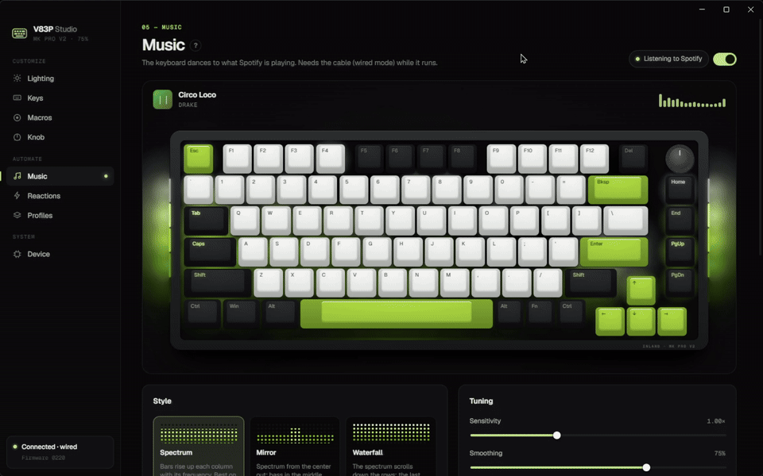
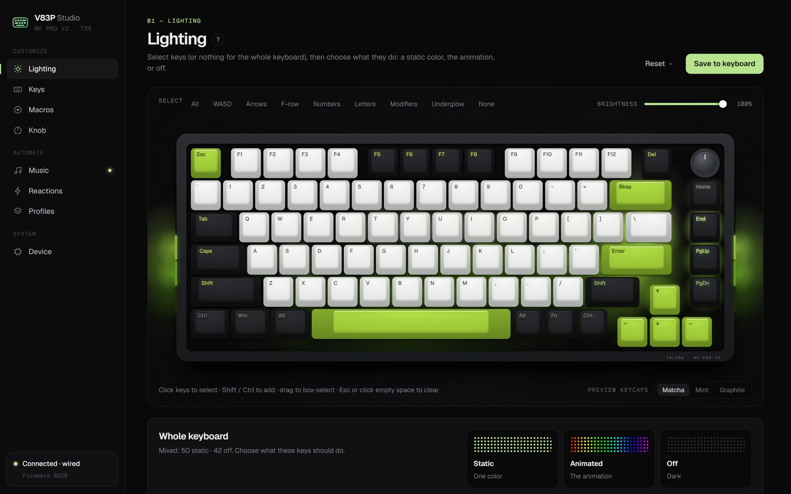
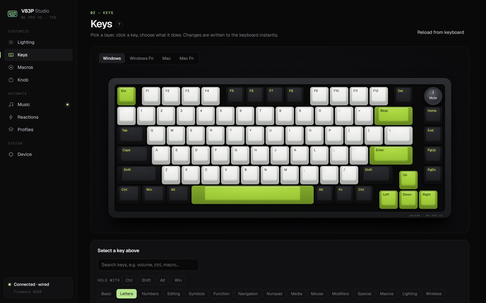
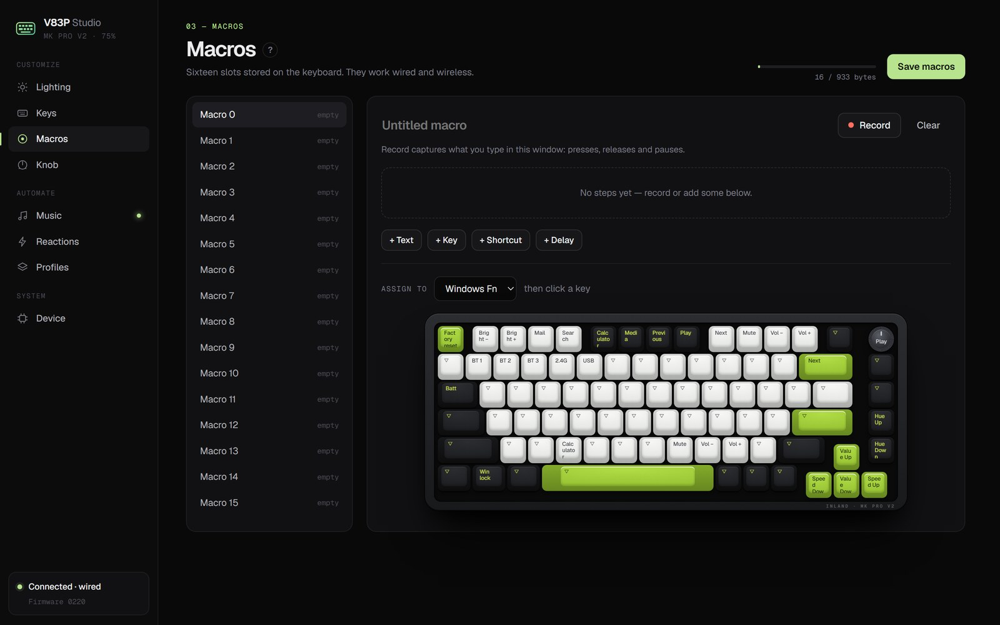
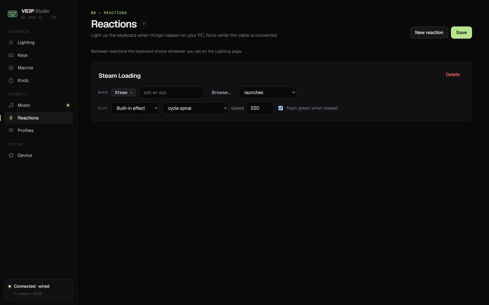
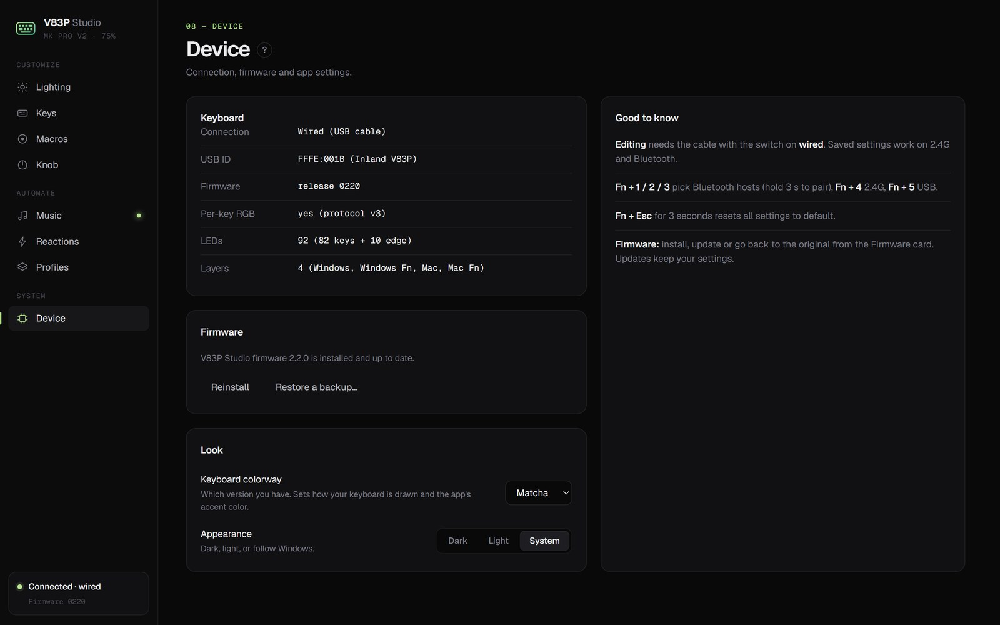

<h1 align="center">V83P Studio</h1>

<p align="center">
  Per-key RGB, Spotify music mode, macros and remapping for the <b>Inland MK PRO V2</b> (V83P) keyboard.<br>
  A Windows app and custom QMK firmware that keeps 2.4G and Bluetooth working.
</p>

<p align="center">
  
</p>

> **Preview release.** It works well on the developer's keyboard, but the firmware has only been tested on one Matcha
> unit so far. The firmware wizard always backs up your keyboard's original firmware first, and you can put it back
> at any time.

## What it does
- **Per-key lighting.** Click keys (or drag a box, or pick WASD / arrows / F-row…) and make each one a static color,
  part of the animation, or off. Mix them freely: static WASD over a rainbow, for example.
- **Music mode.** The keyboard dances to what Spotify is playing: 10 styles (spectrum, beat ripple, fireworks,
  waterfall…), palettes that can follow the album art, and tuning for sensitivity, smoothing and dynamics. It can also
  react to any sound on your PC.
- **Volume display.** Turn the knob and the whole keyboard becomes a volume meter for a moment, sliding smoothly
  left to right, then fades back to your lighting.
- **Reactions.** Light up when something happens: a loading animation while an app starts, or a scene while a game is
  focused.
- **Keys, macros and knob.** Remap all 4 layers, record or build macros (text, keys, shortcuts, delays), and choose what
  the knob does. These are stored on the keyboard, so they work wireless and on any computer.
- **Profiles.** Save everything and switch with one click, from the tray, or automatically per app.
- **Firmware wizard.** Install, update or restore firmware from the app: driver, backup, flash and check, step by step.
- **Looks like your keyboard.** Matcha or Mint keycaps, dark / light / system theme, and a **?** help on every page.

| Lighting | Keys |
|---|---|
|  |  |
| **Macros** | **Reactions** |
|  |  |

## Install
1. Download `V83P-Studio-Setup-<version>.exe` from [Releases](../../releases) and run it. Windows may say
   "Windows protected your PC" because the installer isn't code-signed yet: click **More info → Run anyway**.
2. Plug the keyboard in with the cable (switch on **wired**) and open **V83P Studio**. Pick your colorway.
3. For per-key colors, music mode and reactions, install the firmware: **Device → Firmware → Install firmware**.
   - It backs up your keyboard's original firmware to your PC first.
   - Windows asks once for permission to install the flash driver.
   - You'll unplug the cable, hold **Esc**, and plug it back in. The app tells you when.
   - Your keyboard's settings reset to defaults once. Later updates keep them.

Everything is in the installer: no Python, QMK or other tools needed. Your settings, profiles and firmware backups live
in `%APPDATA%\V83P Studio`.

<p align="center"></p>

## Supported keyboards
| | |
|---|---|
| **Supported** | **Inland MK PRO V2 75%**, **Matcha** and **Mint** colorways (QMK `inland/v83p`, USB ID `FFFE:001B`) |
| **With the V83P Studio firmware** | Everything: per-key lighting, music mode, reactions, live preview of your real colors |
| **With the original firmware** | Effects, brightness, speed, keymap, macros, knob, reactions and profiles. Per-key lighting and music mode are locked until you install the firmware |
| **Not supported** | Any other keyboard, including other Inland models. For other brands, see [OpenRGB](https://openrgb.org) |
| **OS** | Windows 10 / 11 |

## Known limits
- **Windows only.**
- **Editing and live features need the cable.** Changing settings, music mode, reactions and automatic profiles only
  work wired (switch on **wired**). Everything you save keeps working on 2.4G and Bluetooth; the wireless dongle just
  doesn't pass the app's commands through.
- **Music mode follows the Spotify desktop app on this PC.** Spotify playing on your phone or another computer doesn't
  count (or turn off "Only when Spotify is playing" to react to any sound).
- **Reactions only see apps that start after V83P Studio.** Apps that were already open count once you reopen them.
- **Close VIA while V83P Studio is running.** Both talk to the keyboard over the same channel.
- **Tested on one keyboard.** Reports from other units, especially Mint, are very welcome.

## FAQ
**Can this brick my keyboard?** The flash mode is built into the keyboard's chip and can't be overwritten, so a failed
flash can always be retried: hold **Esc** while plugging in, then run the wizard again.

**How do I go back to the original firmware?** Device → Firmware → **Restore a backup…** and pick the backup the wizard
made (`original_<date>.bin`).

**Does it send anything online?** No. The app talks only to your keyboard and runs a local service on `127.0.0.1`,
protected by a random token. Nothing is uploaded.

**Does my lighting work without the app running?** Yes, once you click **Save to keyboard**. Only music mode, reactions
and automatic profiles need the app (it can stay in the tray, and start with Windows).

**I found a bug.** Please [open an issue](../../issues/new/choose) and attach `%APPDATA%\V83P Studio\backend.log`.

## For developers
<details>
<summary>Building, the command line, and adding a keyboard</summary>

### Building from source
- Run it: `pip install -r requirements.txt`, then `cd electron && npm install && npm start` (uses the project folder
  for data).
- Installer: `pip install pyinstaller`, then `cd electron && npm run dist`. This freezes the Python backend into
  `dist/backend` (`tools/build_backend.py`) and builds `dist/installer/V83P-Studio-Setup-<version>.exe`.
- Building in the cloud: [`.github/workflows/build.yml`](.github/workflows/build.yml) builds the installer on GitHub
  Actions for every push to `main`, pull request and manual run (download it from the run's Artifacts). Pushing a
  `v<version>` tag that matches `electron/package.json` also attaches it to that tag's GitHub Release (created as a
  pre-release if needed). CI-built installers are the prerequisite for free code signing through SignPath, whose
  open-source program only signs artifacts built in CI.
- Firmware: see [`firmware/source/README.md`](firmware/source/README.md).
- Bundled third-party tools are listed in [`vendor/README.md`](vendor/README.md).

### Command line
The `mykeys` Python package (the app's backend) also works on its own. It talks to the keyboard over VIA raw HID.

```
pip install -r requirements.txt
python -m mykeys info                      # current lighting
python -m mykeys set --effect solid_color --color "#ff0000" --brightness 200
python -m mykeys set --effect cycle_spiral --speed 200 --save   # --save writes to the keyboard
python -m mykeys effects --cycle           # step through effects to confirm their names
python -m mykeys keys W,A,S,D=#ff0000 ESC=#00ff00 --on           # per-key (V83P Studio firmware)
python -m mykeys flash                     # flash the bundled firmware, keeping settings
```

Live changes stay in RAM; only `--save` persists them.

### Code layout
- `mykeys/device.py`: HID transport (destructive VIA commands are blocked)
- `mykeys/via.py`, `mykeys/perkey.py`: effect lighting (VIA channel 3) and per-key lighting (firmware protocol)
- `mykeys/engine.py`, `mykeys/animations.py`, `mykeys/triggers.py`: reactions
- `mykeys/music/`: audio capture, analysis, Spotify detection and the visualizer styles
- `mykeys/flasher.py`: the firmware wizard
- `mykeys/studio/`: the app's local server and web UI; `electron/`: the desktop shell
- `docs/findings.md`: how the keyboard and its stock firmware were analyzed

### Adding a keyboard
Everything board-specific lives in one folder, `mykeys/boards/<board>/`:
- `board.json`: name, USB IDs, layers, RGB effects, music zones, firmware file
- `layout.json`: key and LED positions (generate with `tools/gen_layout.py` from the board's QMK definition)
- `colorways.json`: keycap colors for the on-screen keyboard

That's enough for effects, keymap, macros and knob on a QMK/VIA board. Per-key colors and music mode also need a
firmware port with the per-key module (`mykeys.c` / `mykeys.h`). Close relatives of this board (same maker, same WB32
chip) such as HFD's M90 and RKB68 are the easiest candidates.
</details>

## License
V83P Studio is free software under the **GNU General Public License v3.0 or later** ([`LICENSE`](LICENSE)). The keyboard
firmware is **GPL-2.0-or-later** like QMK, with its source in [`firmware/source/`](firmware/source/). Bundled third-party
tools and libraries keep their own licenses: see [`THIRD_PARTY_NOTICES.md`](THIRD_PARTY_NOTICES.md) and
[`licenses/`](licenses/).

Not affiliated with Inland or Micro Center.
